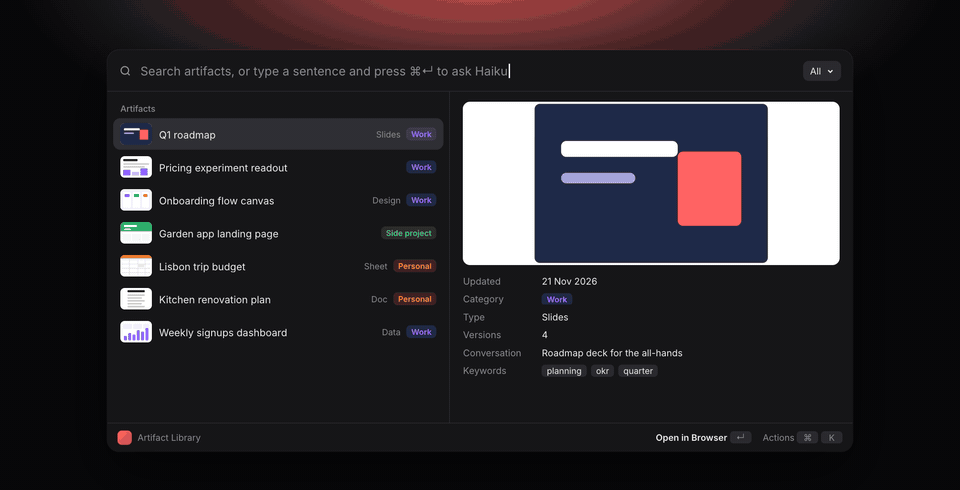

# Raycast Claude Artifact Library



Find every claude.ai artifact you published from Claude Code again, from Raycast.

Each time Claude Code publishes an artifact, a small hook saves it to a local library: a copy of the
page, a thumbnail, its text and a few search keywords that Claude writes for it. In Raycast, "Search
Artifacts" finds it by title, topic or any word on the page. You can also type a vague sentence and let
Claude Haiku turn it into a search.

- **Search:** by any word on the page, ranked by relevance. Filter by type (page, slides, design, doc…).
- **Preview:** a thumbnail of each artifact, with Quick Look (⌘Y).
- **Open:** the artifact in your browser, or the Claude Code conversation that made it (⌘O).
- **Ask Haiku (optional):** ⌘↵ turns "the pricing deck from last month" into keywords and filters.
- **Categories (optional):** sort artifacts by the folder they came from, like Work and Personal.
- **Recording mode:** ⌘⇧R hides private categories while you record your screen.

Works with Claude Code in the terminal, the desktop app and the IDE extensions. In the desktop app,
"Open conversation" jumps back into the session; elsewhere it resumes it in Terminal.

A personal project, not affiliated with Anthropic or Raycast. It reads some Claude Code internals that
can change without notice, so an update may break it. Issues and PRs are welcome, but no support is
promised.

## Install

You need a Mac with [Claude Code](https://claude.com/claude-code), [Raycast](https://raycast.com) and
Node.js 22 or newer. Paste this into Claude Code:

```text
Install https://github.com/alexnb98/raycast-claude-artifact-library and set it up for Raycast. Follow SETUP.md in that repo.
```

Claude then does the rest:

1. Clones the repo to `~/.claude/artifact-library`.
2. Adds the hook to `~/.claude/settings.json` (and keeps a backup).
3. Asks whether you want categories, and which folders belong to each.
4. Offers to import the artifacts you already published.
5. Installs the Raycast extension.

It takes about five minutes. After that, every artifact you publish from Claude Code shows up in Raycast
by itself.

**Does this work in claude.ai?** No. The setup has to install files on your Mac, and only Claude Code can
do that. The library also only collects artifacts published from Claude Code on this Mac. Artifacts you
make in a claude.ai chat don't show up.

## Ask Haiku: create the token

Ask Haiku needs a long-lived Claude token. Create it yourself, and don't paste it into a chat:

1. Open Terminal and run:

   ```bash
   claude setup-token
   ```

   Your browser opens to log in. Then the Terminal prints a token that starts with `sk-ant-oat`.
2. Copy the token.
3. In Raycast, open Search Artifacts, press ⌘K, choose **Configure Command**, and paste the token into
   **Claude token (for Ask Haiku)**. Raycast stores it encrypted.

Each Ask Haiku search is one short request to Claude Haiku on your Claude plan.

## Shortcut

Give Search Artifacts a global hotkey: Raycast settings (⌘,) → Extensions → Artifact Library → Search
Artifacts → Record Hotkey. We suggest ⌃⌥A ("A" for artifacts). Few apps use it.

## Shortcuts in Search Artifacts

| Keys | Does |
|---|---|
| ↵ | Open the artifact in your browser |
| ⌘↵ | Ask Haiku |
| ⌘O | Open the Claude Code conversation that made it |
| ⌘Y | Quick Look the thumbnail |
| ⌘⇧C | Copy the link |
| ⌘⇧F | Show the local file in Finder |
| ⌘⇧R | Recording mode (when a category is private) |
| ⌃X | Remove from the library (the artifact on claude.ai stays) |

## Categories

Categories live in `~/Documents/Artifacts/config.json`. Setup writes it, but you can edit it any time:

```json
{
  "categories": [
    {"name": "work", "label": "Work", "description": "my job projects",
     "folders": ["~/code/acme"], "words": [], "private": false},
    {"name": "personal", "label": "Personal", "description": "travel, home, side projects",
     "folders": ["~/Documents/personal"], "words": ["wedding"], "private": true}
  ]
}
```

- An artifact gets the first category whose `folders` contain the folder Claude Code ran in.
- If no folder matches, a word from `words` in its title or description decides.
- If nothing matches, it has no category.
- `private: true` hides the category in Recording mode.

After you change the rules, sort the existing artifacts again:

```bash
/usr/bin/python3 ~/.claude/artifact-library/scripts/artlib.py recategorize --all
```

To give a single artifact a category by hand:
`artlib.py set-meta <id> --area personal`. Later publishes keep it.

## Where things are

| What | Where |
|---|---|
| Code | `~/.claude/artifact-library` |
| Library (database, page copies, thumbnails) | `~/Documents/Artifacts` |
| Errors | `~/Documents/Artifacts/errors.log` |
| Hook | `~/.claude/settings.json`, PostToolUse on `Artifact` |

Everything stays on your Mac. The only network calls are the ones Claude Code makes anyway, and Ask
Haiku if you use it. Thumbnails are rendered with a headless Chrome, Chromium, Brave or Edge if one is
installed. Without one, artifacts get a title card.

## Uninstall

```bash
/usr/bin/python3 ~/.claude/artifact-library/scripts/install.py --remove
```

Then remove the extension in Raycast and delete `~/.claude/artifact-library`. Your library in
`~/Documents/Artifacts` stays until you delete it.

## Development

```bash
/usr/bin/python3 -m unittest discover -s tests
```

```bash
cd raycast && npm install && npm test
```

The search rule exists twice, in `scripts/artlib.py` and `raycast/src/fts-artifacts.ts`. The tests fail if
they drift apart.

## License

MIT, see [LICENSE](LICENSE).
